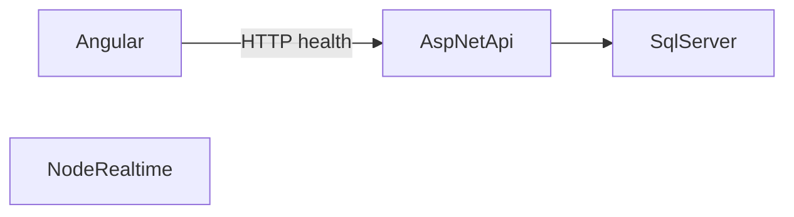

# Architecture

Phase 0 runs three processes and one database. Later phases add behavior inside these same units.

The Angular app is the only UI. It calls the API. In Phase 0 that call is `GET /health` via the dev proxy, so the browser stays on `localhost:4200`. The realtime process exposes its own `GET /health` and does not call the API yet. Phase 5 adds Socket.IO, seat tokens, and a persistence callback. Veto state will live in memory on one instance. That limit is recorded in ADR-001.

## API layers

| Project | Owns |
| --- | --- |
| ScrimHub.Domain | Entity base type: `Guid` id and UTC timestamps |
| ScrimHub.Application | Use-case layer. Empty until Phase 1 |
| ScrimHub.Infrastructure | `ScrimHubDbContext`, design-time factory, local `.env` reader |
| ScrimHub.Api | HTTP composition: OpenAPI, problem details, Serilog, health |

There is no MediatR and no CQRS. The first EF migration is the empty model snapshot. Feature tables arrive with the phase that needs them. The API does not apply migrations on startup.

## Auth decision, not implemented

Phase 1 will issue a short-lived JWT access token kept in memory, and a refresh token in an `httpOnly` `Secure` cookie. ADR-002 records the SameSite constraint between Static Web Apps and App Service.

## Reference data

Not in Phase 0. When it arrives, the API will cache valorant-api.com. The browser will not call that site.

## Production shape

Azure Static Web Apps hosts the Angular build. One Linux App Service plan hosts the API and the realtime app. Azure SQL stores data. Key Vault holds secrets. Application Insights receives telemetry once a connection string is configured. See the cost notes in the root README. Do not treat those SKUs as a price quote.
